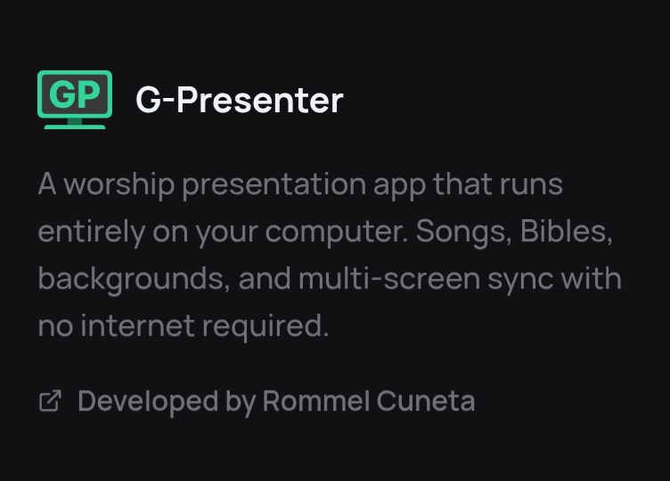
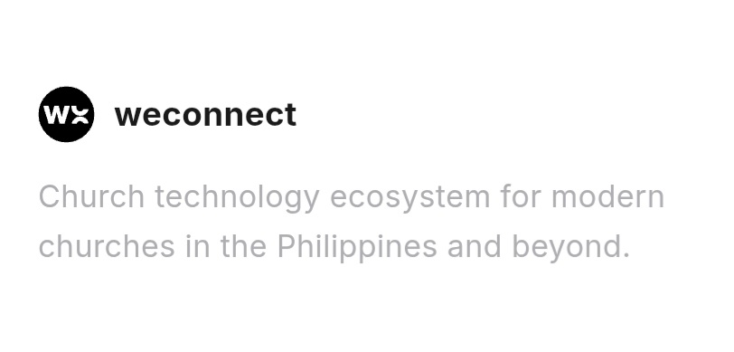

For years, our church relied on the free version of [EasyWorship](https://easyworship.com) as our presentation software. When I became the lyrics operator, I continued using it for a couple more years. But around November last year, I reached a point where I simply couldn’t tolerate how slow it had become.

At first, people thought I was the one being slow—but it wasn’t me. The application itself was struggling. We were using an old laptop, and *EasyWorship 7* would consume nearly all of its CPU, making it difficult to keep up during services.

So I started searching for alternatives. I tried several presentation software options online until I discovered [FreeShow](https://freeshow.app).

What caught my attention was their mission: to provide small churches with a free tool that offers features comparable to paid software. Even better, it’s open-source.

If you know me, you’ll know I have a strong preference for free and open-source software (FOSS). I even starred [their repository on GitHub](). While I understand that developers need to earn, there’s something deeply meaningful about building tools with passion and a heart for serving the Lord. The impact of that kind of work goes beyond money—our reward is in heaven.

Just this month, I came across two more presentation tools: [G-Presenter](https://gpresenter.com) and [WeConnect](https://weconnectph.com). Honestly, I was both surprised and impressed to see locally developed software for church media. That’s something worth celebrating.

That said, I often hear the phrase “support local.” I understand the sentiment, and I do value it. However, the reality is that our church doesn’t have the budget for monthly subscriptions. Both platforms offer a 14-day trial, but continued use requires payment.

So for now, my stance is this: support tools that also support the church’s reality.

That’s why I’m sticking with *FreeShow*.

